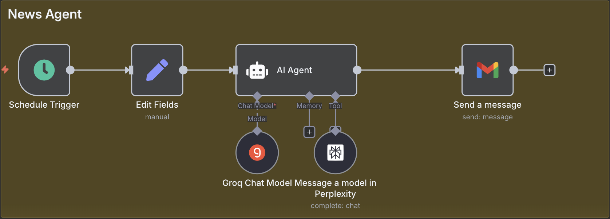
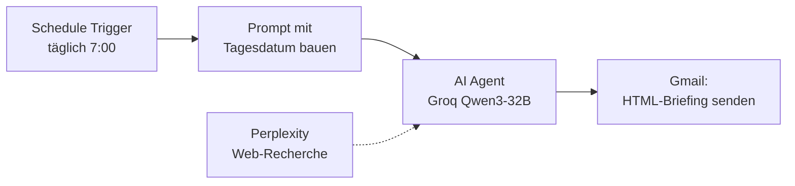

# 📰 News-Agent: Tägliches Nachrichten-Briefing per E-Mail

Ein automatisierter Agent, der jeden Morgen um 7 Uhr die wichtigsten Nachrichten des Tages recherchiert, in einer HTML-Übersicht zusammenfasst und per E-Mail verschickt.

**Tech:** n8n · Groq (Qwen3-32B) · Perplexity · Gmail · Prompt Engineering
**Workflow:** [`workflow.json`](workflow.json) (in n8n importierbar)



---

## Ablauf



## Was der Agent macht

1. **Zeitgesteuert:** Der Schedule Trigger startet den Workflow täglich um 7 Uhr (Zeitzone Europe/Berlin) und liefert das aktuelle Datum.
2. **Dynamischer Prompt:** Das Datum wird in einen Prompt eingesetzt, der vier Kategorien vorgibt: *Allgemeine Nachrichten, Finanzen, Politik, Tech/IT/KI*. Jede Kategorie wird einmal für **Deutschland** und einmal **international** abgedeckt, Schwerpunkt auf KI und Machine Learning.
3. **Recherche:** Der LLM-Agent nutzt Perplexity als Tool, um aktuelle Meldungen aus Medien, Foren und Social Media zu finden.
4. **Formatierung über Few-Shot-Template:** Der Prompt enthält eine vollständige Beispiel-Ausgabe als HTML. Daran orientiert sich das Modell, sodass jede Mail dieselbe Struktur hat und direkt als HTML-Mail versendet werden kann.
5. **Versand** per Gmail.

## Erkenntnisse

- Ein **Beispiel-Output im Prompt** (Few-Shot) gibt dem Modell ein konkretes Zielformat vor, statt es nur zu beschreiben.
- LLMs neigen dazu, HTML in Markdown-Codeblöcke (` ```html `) zu packen. Das musste explizit im System-Prompt unterbunden werden.

## Selbst ausprobieren

1. `workflow.json` in n8n importieren
2. Zugangsdaten für Groq, Perplexity und Gmail hinterlegen
3. Im Node *Send a message* die eigene Empfängeradresse eintragen (Platzhalter `empfaenger@example.com`)
