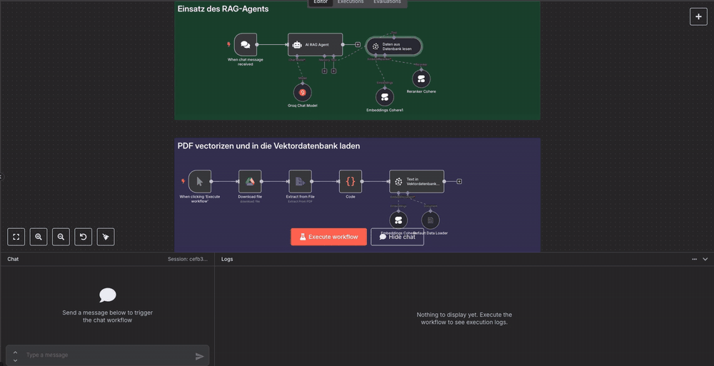
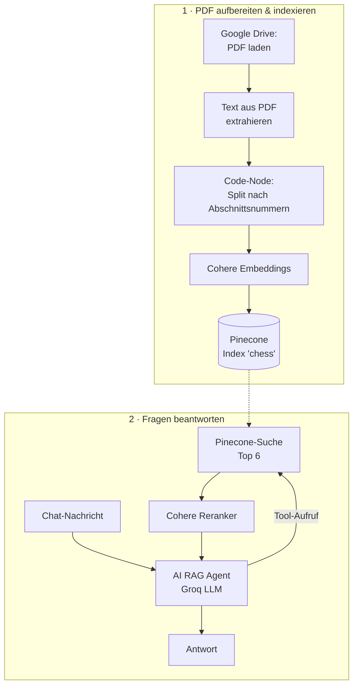
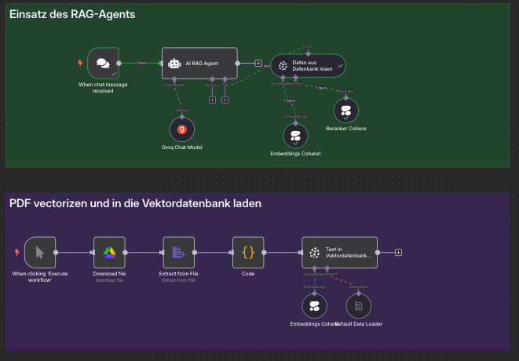

# ♟️ RAG-Agent mit Pinecone & Cohere-Reranking

Ein Chat-Agent, der Fragen auf Basis eines eigenen Dokuments beantwortet, in diesem Fall eines Regelwerks zum Schachspiel. Der Workflow besteht aus zwei Teilen: einer **Ingestion-Pipeline**, die das PDF aufbereitet und in eine Vektordatenbank lädt, und dem **RAG-Agenten**, der bei jeder Frage die passenden Abschnitte abruft.

**Tech:** n8n · Pinecone · Cohere (embed-multilingual-v3.0, rerank-multilingual-v3.0) · Groq · Google Drive · JavaScript
**Workflow:** [`workflow.json`](workflow.json) (in n8n importierbar)

---

## Architektur

## Technische Highlights

- **Chunking nach Struktur statt nach Zeichenzahl:** Ein eigener JavaScript-Code-Node zerlegt das Dokument entlang seiner Abschnittsnummern (`1.`, `1.1`, `2.` …). So bleibt jede Regel als zusammenhängender Abschnitt erhalten. Titel und Abschnittsnummer werden als Metadaten mitgespeichert.
- **Mehrsprachige Embeddings:** Das Cohere-Modell `embed-multilingual-v3.0` funktioniert mit deutschem Text.
- **Reranking:** Die Vektorsuche liefert die 6 ähnlichsten Abschnitte, ein Cohere-Reranker sortiert sie anschließend nach ihrer Relevanz zur konkreten Frage. So landen die wirklich passenden Abschnitte im Kontext des LLM, nicht nur die ähnlich klingenden.
- **Retrieval als Tool:** Die Vektordatenbank ist als Werkzeug an den Agenten angebunden. Der Agent entscheidet selbst, wann er nachschlägt.

## Selbst ausprobieren

1. `workflow.json` in n8n importieren
2. Zugangsdaten für Google Drive, Pinecone, Cohere und Groq hinterlegen
3. Pinecone-Index anlegen (Dimension 1024 für `embed-multilingual-v3.0`)
4. Im Node *Download file* die eigene PDF-Datei auswählen (Platzhalter `DEINE_GOOGLE_DRIVE_FILE_ID`) und den Ingestion-Teil einmal manuell ausführen

*Das verwendete Regel-PDF ist aus urheberrechtlichen Gründen nicht im Repo enthalten.*
