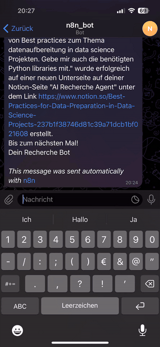
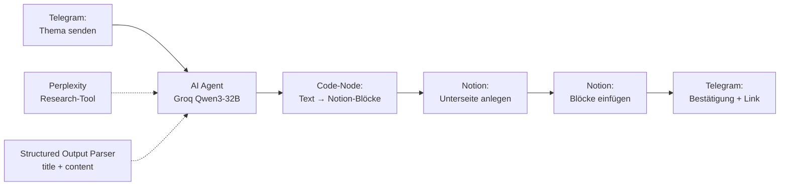
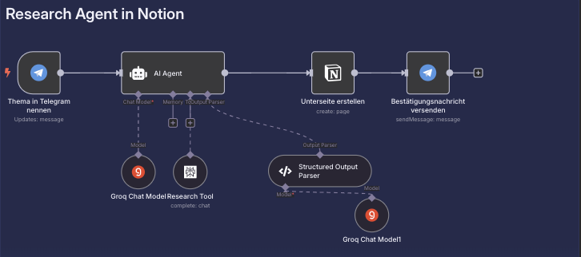

# 🔎 Recherche-Agent: Telegram → Perplexity → Notion

Ein KI-Agent, der auf Zuruf recherchiert: Ich schicke ein Thema per Telegram, der Agent recherchiert es mit Perplexity, legt eine formatierte Unterseite in Notion an und schickt mir den Link zurück.

**Tech:** n8n · Groq (Qwen3-32B) · Perplexity (sonar-pro) · Notion API · Telegram Bot API · JavaScript
**Workflow:** [`workflow.json`](workflow.json) (in n8n importierbar)

  

---

## Ablauf

## Was der Agent macht

1. **Trigger:** Eine Telegram-Nachricht an den Bot startet den Workflow. Der Nachrichtentext ist das Recherchethema.
2. **Recherche:** Ein LLM-Agent (Qwen3-32B über Groq) nutzt Perplexity als Werkzeug für aktuelle Webinformationen.
3. **Strukturierte Ausgabe:** Ein Output Parser zwingt die Antwort in ein festes JSON-Format (`title`, `content`, max. 2.000 Zeichen, wegen des Notion-Limits pro Textblock). Mit `autoFix` repariert ein zweites Modell fehlerhafte Ausgaben.
4. **Formatierung:** Ein eigener JavaScript-Code-Node wandelt den Text in Notion-Blöcke um (Überschriften `##` → `heading_2`, sonst Absätze).
5. **Ablage & Rückmeldung:** Notion-Unterseite anlegen, Inhalt einfügen, Link per Telegram zurückschicken.

## Technische Details

- **Tool Use:** Der Agent entscheidet selbst, wann und wie oft er Perplexity aufruft.
- **Structured Output:** Verlässliche Weiterverarbeitung, weil das LLM-Ergebnis immer dasselbe Schema hat.
- Ausgangspunkt war eine n8n-Community-Vorlage, die ich angepasst und erweitert habe.

## Selbst ausprobieren

1. `workflow.json` in n8n importieren (*Workflows → Import from File*)
2. Zugangsdaten für Telegram, Groq, Perplexity und Notion hinterlegen
3. Im Node *Unterseite erstellen* die eigene Notion-Seite eintragen (Platzhalter `DEINE-NOTION-SEITE`)
