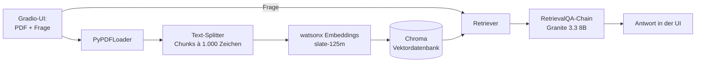

# 📄 RAG-PDF-Assistent mit LangChain, IBM watsonx & Gradio

Eine kleine Web-App: PDF hochladen, Frage stellen, Antwort erhalten, die sich auf den Inhalt des Dokuments stützt. Umgesetzt mit **Retrieval-Augmented Generation (RAG)**: Das Sprachmodell antwortet nicht aus seinem allgemeinen Wissen, sondern auf Basis der passenden Textstellen aus dem PDF. Das reduziert Halluzinationen.

> **Hinweis:** Projekt aus dem **IBM Data Science Professional Certificate** (IBM Skills Network). Der Code ist auf die Lab-Umgebung des Kurses ausgelegt (`project_id = "skills-network"`). Für den lokalen Betrieb braucht es ein eigenes IBM-watsonx-Projekt mit API-Key.

**Tech:** Python · LangChain · IBM watsonx (Granite 3.3 8B, Slate Embeddings) · Chroma · Gradio
**Code:** [`qa_bot.py`](qa_bot.py)

---

## Architektur

## Funktionsweise

1. **Laden & Zerlegen:** Das PDF wird eingelesen und in Abschnitte („Chunks“) von je 1.000 Zeichen geteilt.
2. **Vektorisieren:** Jeder Chunk wird mit einem Embedding-Modell in einen Zahlenvektor übersetzt und in Chroma gespeichert.
3. **Suchen:** Zur Frage werden die inhaltlich ähnlichsten Chunks gesucht.
4. **Antworten:** Das LLM (IBM Granite) formuliert aus diesen Chunks eine Antwort.

## Bausteine

| Baustein | Aufgabe |
|---|---|
| **Gradio** | Web-Oberfläche mit Datei-Upload und Eingabefeld, ohne eigenes Web-Framework |
| **LangChain** | Steuert den Ablauf: Laden, Splitten, Embeddings, Retriever und QA-Chain |
| **Chroma** | In-Memory-Vektordatenbank für die Ähnlichkeitssuche |
| **IBM watsonx** | Stellt Sprachmodell (Granite 3.3 8B Instruct) und Embedding-Modell (Slate 125M) bereit |

## Weiterentwicklung

- Quellenangaben (Seitenzahl/Abschnitt) zur Antwort anzeigen
- Vektordatenbank zwischenspeichern, statt sie bei jeder Frage neu aufzubauen
- Chunk-Größe und Überlappung systematisch testen
